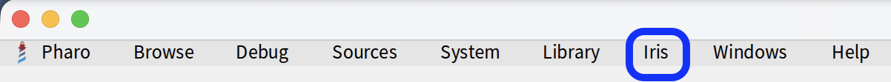
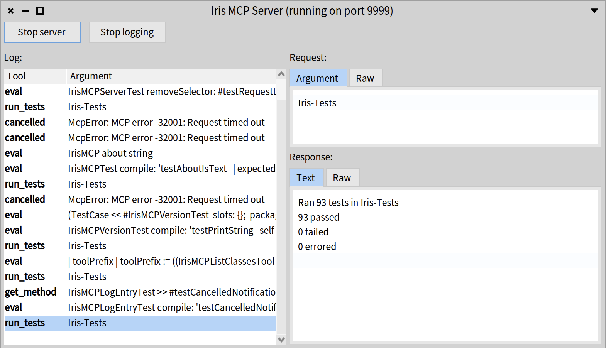

[](https://github.com/koendehondt/iris-for-pharo/actions/workflows/Pharo13.yml) [](https://codecov.io/gh/koendehondt/iris-for-pharo)

[](https://github.com/koendehondt/iris-for-pharo/actions/workflows/Pharo14.yml)

# Iris

Iris is a [Model Context Protocol](https://modelcontextprotocol.io) (MCP) server running inside a live [Pharo](https://pharo.org) image.

It was developed with [Claude AI](https://claude.com/product/overview) in several pair programming sessions.

It allows Claude Desktop (or any MCP client) to inspect and interact with a running Pharo image.

## Tools

| Tool | Description | Parameters |
|------|-------------|------------|
| `pharo:eval` | Evaluates a Smalltalk expression in the Pharo image and returns the `printString` of the result | `expression` *(string, required)* |
| `pharo:get_class` | Returns the definition and all method sources for a named class, both instance-side and class-side | `class_name` *(string, required)* |
| `pharo:get_method` | Returns the source of a single method | `class_name` *(string, required)*, `selector` *(string, required)*, `class_side` *(boolean, optional)* |
| `pharo:list_classes` | Lists all classes in the image, with optional filtering | `prefix` *(string, optional)*, `package` *(string, optional)* |
| `pharo:run_tests` | Runs a `TestCase` subclass (or a single test method) and returns pass/fail/error counts with failure messages. Alternatively, runs all `TestCase` subclasses in a package | `class_name` *(string, optional)*, `package` *(string, optional)*, `selector` *(string, optional)* |

## Architecture

Iris exposes an HTTP server accepting JSON-RPC requests following MCP on a `/mcp` endpoint.
Many agents expect a binary that speaks the same protocol over its standard input and output.
In those cases you need a proxy to translate between the two.
In that case, the flow is as follows:

```
Claude Desktop
    ↕ stdio
mcp-remote (Node.js proxy)
    ↕ HTTP POST /mcp JSON-RPC
Pharo Image (Zinc HTTP server on port 9999)
```

Some agents can talk directly to a `remote` MCP server like Iris, even though it runs locally.
In that case, the flow is simpler:

```
OpenCode
    ↕ HTTP POST /mcp JSON-RPC
Pharo Image (Zinc HTTP server on port 9999)
```


## Installation

```smalltalk
Metacello new
    baseline: 'Iris';
    repository: 'github://koendehondt/iris-for-pharo:main';
    onConflict: [ :e | e useIncoming ];
    onUpgrade: [ :e | e useIncoming ];
    ignoreImage;
    load
```

## Starting and stopping the server by hand

```smalltalk
"IrisMCPServer implements the Singleton design pattern."
IrisMCPServer current.

"Starting the server."
IrisMCPServer current start.

"Checkng whether the server is running."
IrisMCPServer current isRunning.

"Stopping the server."
IrisMCPServer current stop
```

By default, the server runs on port 9999. To run on a custom port, 8888 for instance, evaluate

```smalltalk
IrisMCPServer current stop.
IrisMCPServer current: (IrisMCPServer onPort: 8888).
IrisMCPServer current start
```

## Starting and stopping logging by hand

The server keeps a log of the incoming requests and the corresponding responses. Logging can be turned on and off.

```smalltalk
"Start logging."
IrisMCPServer current startLogging.

"Checkng whether the server is logging."
IrisMCPServer current isLogging.

"Stop logging."
IrisMCPServer current stopLogging.
```

## Managing the server

The Pharo menubar includes an `Iris` menu, with a command to open the Iris MCP Server.



The window is a kind of console to start and stop the server, to start and stop logging, and to browse the log.
Browsing the log is handy to keep an eye on what the agent is doing inside the Pharo image.




## Claude Desktop Configuration

Install [mcp-remote](https://github.com/geelen/mcp-remote) and add to `~/Library/Application Support/Claude/claude_desktop_config.json`:

```json
{
  "mcpServers": {
    "pharo": {
      "command": "/path/to/node",
      "args": [
        "/path/to/mcp-remote/dist/proxy.js",
        "http://localhost:9999/mcp"
      ]
    }
  }
}
```


## OpenCode Configuration

Edit OpenCode's configuration file, `~/.config/opencode/opencode.jsonc` along this example:

```json
{
  "$schema": "https://opencode.ai/config.json",
  "mcp": {
    "servers": {
      "pharo": { "type": "remote", "url": "http://127.0.0.1:9999/mcp" }
    }
  }
}
```

If you check the list of MCP servers available in OpenCode and Iris is not yet running,
it will mark and cache that MCP server as unavailable during that session. 
You need to reload or restart OpenCode once Iris is running.

Using `127.0.0.1` instead of `localhost` signals more clearly that Iris binds only on IPv4.
